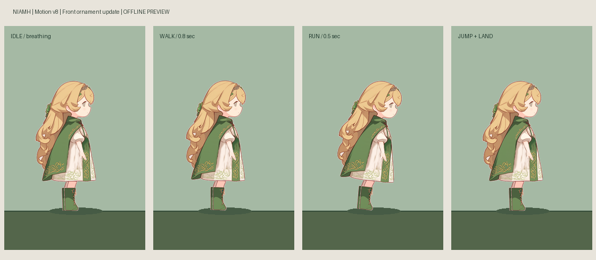

# 妮芙动作试做 v8

**日期**：2026-11-14

**给谁读**：项目负责人、学生、美术制作人员和接手的 Agent。

**当前结论**：六部件动作已接入《妖精丘陵》的 Unity 试玩版，在村庄和森林进行了 Play Mode 检查。项目负责人试玩后认为“除了一些卡顿，其他基本 ok”。卡顿原因未测量；这也不是完整的 22 骨骼角色绑定。

> 本目录保存**美术来源与离线预览**。Unity 中实际运行的 prefab、动画、截图和检查记录在另一仓库 `TheFairyHill2D/Assets/_Project/Art/Characters/Niamh/Motion_v8_Trial/` 与 `TheFairyHill2D/Docs/Niamh_Motion_v8_Unity_Handoff.md`。下图上的 “NOT IN UNITY” 是制作预览时的历史标注，不能代表目前的接入状态。

*图：v8 离线姿势预览，供比较动作和造型；游戏中的动作时长已按实际控制器重新安排。动态图见 [v8 GIF](previews/Niamh_motion_v8.gif)。*

## 这轮做了什么

用户在 Photoshop 的 `_m` 文件中补画了头肩、手臂、腿和靴子。v8 保留这些修改，沿用六张同画布透明部件：头、后发、身体连衣裙及披风、手臂、整腿、靴子。六张图均为 327 × 699 像素；远侧腿在 Unity 中由近侧腿复制并调暗，属于试做办法。

动作覆盖现有村庄与森林场景要用的待机、走、跑、跳起、空中、下落和轻微落地。按用户标注，下落时头往下看、手往后、腿往前；在离线预览约 1.025 秒处摆幅最大，接近落地时归位。跳起时则抬头、手往前、腿往后。落地不再做明显的整身压缩，脚保持接地。

## 当前验证与待办

- **已验证**：Unity 导入与编译；真实工程中的村庄、森林角色显示与基本动作切换；项目负责人完成试玩并给出上述总体反馈。Unity 端证据见 `Docs/References/Niamh_Motion_v8/Unity_Trial/`。
- **未单独验证**：5.6u/s 跑速、栅门开关等交互的逐项录像；卡顿原因；完整骨骼、肘膝弯曲及披风独立运动。
- **下一步**：结合试玩画面检查手臂背后的缺画、腿靴接缝和脚底滑动；若要做推门或举十字架动作，先对照现有场景交互决定触发时机和需要补画的手型，再制作新版本。不要把 v8 试做当作这些动作已经完成。

## 文件与用途

- `Niamh_user_revision_source.psd`：用户 `_m` 修订版的快照；不要用旧切件脚本覆盖。
- `parts/`：六张同画布 PNG，是本次 Unity 试玩的美术输入。
- `previews/`：GIF、姿势图和下落对照图，均为**离线**参考。
- `references/user_fall_swing.png`：用户对下落摆幅的标注。
- `motion_preview_spec.json` 与 `tools/render_preview.py`：离线预览的枢轴、时序和生成方法；2 秒跳跃循环不等于游戏实际跳跃时长。
- `UNITY_TRIAL_README.md`：Unity 实现约束、尺寸、风险和结果入口。

完整的制作经验见 `TechnicalArt/LESSONS_CHARACTER_ANIMATION.md`；原始 Unity 任务单见 `CommandForAgentToInitialRun/2026-11-14_Niamh_Motion_v8_Unity_Trial.md`，该任务已执行，不能当作未开始的指令重新运行。
