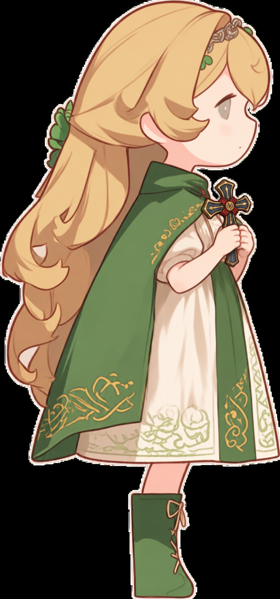

# 妮芙双手捧十字架动作参考

日期：2026-11-16
读者：项目负责人、学生、美术制作人员及后续协作者
状态：**姿势与风格方向已由负责人认可；离线动画和 Unity 验收尚未开始。**

## 这张图说明什么

妮芙把家传铁十字架捧在胸前，双臂弯曲，双手共同握住十字架。负责人认为角色画法与游戏内妮芙能够接上，同意以此方向继续制作。

这是一张静态生成概念图。它不代表角色立绘已改版，也不是已拆开的动画素材、已完成的动作循环或 Unity 试玩结果。认可只覆盖当前图片表达的姿势和风格方向。

## 生成过程

1. 先检查 ImageGen 能否结合游戏内角色和道具直接生成合适结果。
2. 需要姿势探索时，由负责人在 Discord 的 Midjourney 对话中生成候选。四格图中选择 U2（右上）作为双臂弯曲、双手持物的姿势参考；MJ 角色本身不作为妮芙新设定。
3. 用 Codex 内置 ImageGen 综合游戏内妮芙侧面图、MJ U2 姿势图和游戏内十字架资产，生成当前概念图。参考图都保存在同一研究目录或由跨仓库 Unity 工程提供。
4. 负责人把结果与现有游戏内侧面角色比较后，认可其风格与姿势方向。

ImageGen 界面没有提供可核实的后端模型版本，完整提示词也没有存档，因此不把它标为 Google Imagen，也不补写猜测的模型名或提示词。

## 研究素材

目录：`TechArtAsset/Characters/Niamh/Interaction_Study_2026-11-16/`

- `Niamh_two_hands_pose_study_v1.png`：目前认可的双手捧十字架概念图，由 Codex 内置 ImageGen 生成。
- `MJ_two_hands_U2_original.png`：Discord 下载的 Midjourney 姿势参考整图；U2 是右上格，只借用姿势。
- `grip_imagegen_2026-11-15_reference.png`：较早的握持手臂单独试验，作为研究记录保留。

身份和画风基准：`TechArtAsset/Characters/Niamh/Niamh_side_static_v3.png`。道具基准：Unity 工程 `Assets/_Project/Art/Backgrounds/S1b_ForestPath/props/F_prop_cross_v2.png`。

## 接下来怎么做

1. 以用户修订的 `_m` PSD 和 Motion_v8 六部件为制作基准，确定肩、上臂、前臂、手、十字架之间的前后遮挡关系。保留原文件，所有补画和导出另存版本。
2. 检查静态正位，补齐手臂移动后会露出的衣袖/披风区域；概念图只供对照，不直接裁切为最终游戏部件。
3. 做一张接近游戏实际比例的姿势对照，再制作离线关键帧/GIF。重点检查肩线、手指握持、十字架角度、袖口、披风遮挡、边缘接缝和人物整体身份。
4. 交负责人审看离线结果。通过后，再准备单独 Unity 任务，写明输入文件、允许修改范围、备份/回退方法和验收条件。

栅门推门是另一组动作，需要独立姿势研究和离线审看；不能从这张捧十字架概念图推定已经完成。

## 项目记录入口

- 全局美术进度：`../ART_HANDOFF.md`
- 本地续接：`../STORYBOARD_RESUME.md`
- Agent 生成方法：`../AGENT_PROCESS_GUIDELINES.md` §5.8
- 动作制作经验：`LESSONS_CHARACTER_ANIMATION.md` Trial 2
- 知识库状态：`STORYBOARD_KNOWLEDGE_BASE.md`
